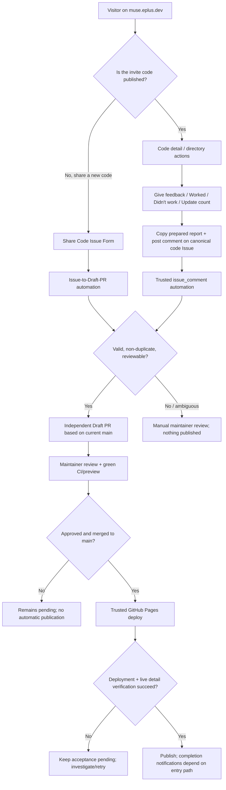
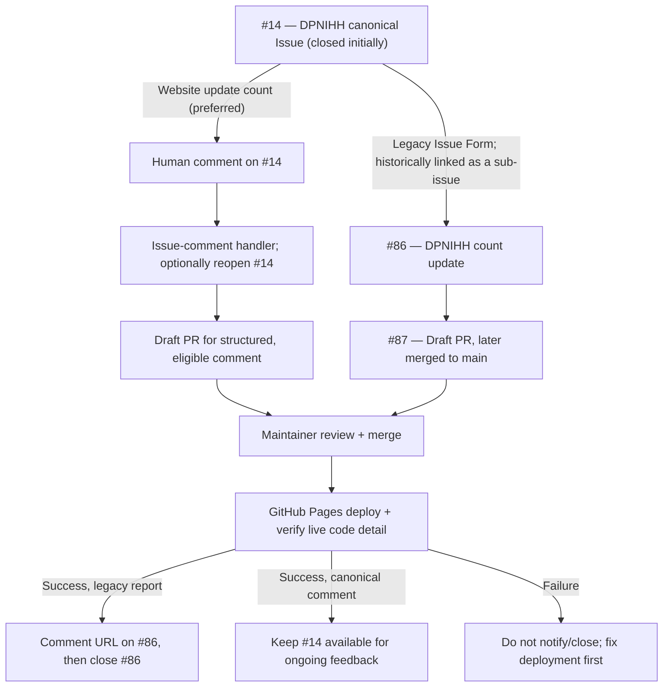

# Contribution and feedback flow

This page visualizes the **current** Muse Invite Hub automation. It is not a proposal to auto-merge public submissions. The default website flow for a **published** code uses comments on **one canonical GitHub Issue**; a new Issue Form is for a new code. Older count/feedback Issue Forms remain supported for compatibility. For maintainer rules, see [CONTRIBUTING.md](../CONTRIBUTING.md).

## Choose the right entry point

### What happens to the Issue?

| Entry point | GitHub thread | After successful review and deployment |
| --- | --- | --- |
| **New code submission** | New Issue with a bot-created review-only Draft PR | Bot posts the canonical detail link **then closes the submitted Issue**; that Issue remains the code's canonical feedback thread. |
| **Existing-code comment** (preferred for quota or redemption reports) | Comment on the code's mapped canonical Issue. Trusted automation can reopen a closed Issue and propose a Draft PR **per structured comment**. | The published catalog reflects the reviewed merge; the automation already posts a **Draft PR link** on the canonical thread, but it does **not currently send a separate post-deployment acceptance comment** for comment-origin PRs. The canonical thread is **not automatically closed again** by the acceptance reconciler after feedback reopening. |
| **Legacy count/feedback Issue Form** | Separate Issue; it may be linked as a GitHub sub-issue under the original code Issue. The normal Issue-to-PR bot can propose a Draft PR. | Once the accepted PR's merge is on the deployed site and the live code detail responds, the bot posts the detail URL **before closing the report Issue**. The canonical code Issue remains the canonical thread. |
| **Informal report, source mismatch, ownership dispute, or conflicting data** | Existing canonical Issue comment or special review Issue; no automatic catalog update. | Maintainer must resolve; no merge or closure is implied by a mere comment. |

The site treats the GitHub Issue number in `data/code-issues.json` as the **one canonical feedback link** for each published code. Other reports about the same code must not replace it. A separate GitHub sub-issue is not required for an ordinary count update.

## Concrete example: DPNIHH

**Verified example:** #86 is a GitHub sub-issue of [#14](https://github.com/ePlus-DEV/muse-invite-hub/issues/14). [PR #87](https://github.com/ePlus-DEV/muse-invite-hub/pull/87) merged its count update, but the deployment failed before the Issue-closing step because the feedback map mistook a new count-report Issue for a duplicate canonical Issue. [PR #88](https://github.com/ePlus-DEV/muse-invite-hub/pull/88) proposes a correction; it must be merged and deployed successfully for the normal acceptance flow to finish. These links document a historical example, not a promise that the Issue is already closed.

## Automation and safety boundaries

- [Issue to Draft PR](../.github/workflows/issue-to-pr.yml) and `scripts/issue-to-pr.mjs`: new-code Issue Forms and legacy standalone count/feedback Issue Forms; no auto-merge.
- [Reopen Code Feedback Issue](../.github/workflows/reopen-code-feedback.yml), `scripts/reopen-code-feedback.mjs`, and `scripts/feedback-comment-to-pr.mjs`: human comments on the canonical code Issue; only structured, eligible comments can create a review-only Draft PR. Bot comments are ignored.
- [Deploy website to GitHub Pages](../.github/workflows/pages.yml) and `scripts/close-accepted-issues.mjs`: trusted `main` only; verify deployment, merged PR ancestry and production detail; accepted-contributor comment **before** closing eligible contribution/legacy report Issues. Failed deployment or missing verification leaves them open.
- Feedback/comment processing never treats a copied code, a community claim or an owner-reported quota as independently verified Muse redemption. Workflows do not merge PRs automatically.
- Parent/sub-issue structure organizes legacy or exceptional requests; the parent remains the stable website feedback URL and ordinary updates should use comments.

[Back to README](../README.md) · [Contribution instructions](../CONTRIBUTING.md)
