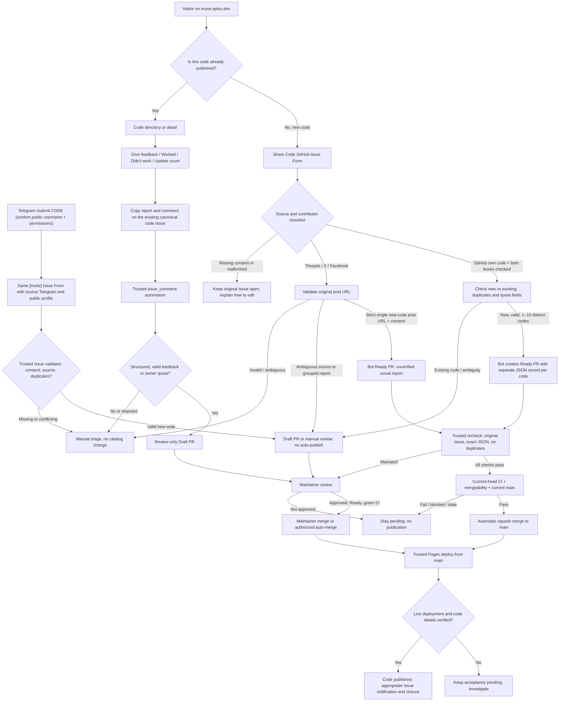
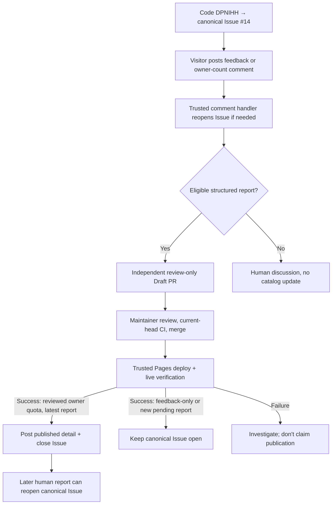

# Contribution and feedback flow

This page describes the review and publication rules of Muse Invite Hub. **Eligible new GitHub-owned codes and strict single-code public social-post reports can publish automatically as `unverified`** after guarded checks. Existing-code updates and feedback still require maintainer review. Owner-count comment completion is reconciled by the trusted Pages deployment after an approved merge, while feedback-only discussions remain open. Publishing an entry does **not** verify that Muse will accept the code or that invitations remain.

See [CONTRIBUTING.md](../CONTRIBUTING.md) for contributor instructions, [AGENTS.md](../AGENTS.md) for mandatory rules, and [PROJECT_GUIDE.md](PROJECT_GUIDE.md) for implementation details.

## 1. Choose the right entry point

For grouped submissions (2–10 codes), each code is stored in its own `data/invite-records/<id>.json` record. Per-code quota/usage figures must be omitted for grouped Issues. Duplicate codes or an existing-code update are **not** eligible for automatic new-code publication.

Telegram accepts six-character codes and records the **sender's Telegram @username** from Telegram's private-chat update **only after explicit public attribution and sharing/privacy consent**. Numeric Telegram IDs and per-chat Issue history remain private. A new Telegram contribution uses the **same `[Invite] CODE` title, section order and Contributor checklist wording** as a GitHub Share Code Issue. `Code source` is Telegram, the public `t.me/@username` profile is in the existing **Public confirmation or context** field and the contributor is noted in the existing **Notes** field. Only an internal marker signals that GitHub's Issue author is the service bot. A Telegram profile URL is not proof of ownership or original public post. The **GitHub Issue author is the bot**; the trusted Issue-to-PR workflow parses the same form headings while checking the Telegram provenance marker before evaluating ownership. The trusted Issue-to-PR workflow now checks the sender's consented public username, source URL, Issue marker, bot author and duplicates, then automatically **creates a review-only Draft PR** for a structurally valid new Telegram code. The Draft PR is never eligible for automatic publication; a maintainer must independently verify authenticity and sharing permission before making it ready or merging. Repeat submissions to a closed, unpublished Issue return the closed link without duplication. After accepted live publication, comment the canonical code link before closing the Issue.

## 2. Auto-publish vs review

| Submission or PR | Result |
| --- | --- |
| New **GitHub (my own code)** Issue; both contributor confirmations checked; no duplicate; exact bot-generated record(s) | Bot creates a **Ready PR**. Trusted automation verifies the original Issue, current catalog, all changed JSON files, green CI and clean merge before **automatic merge**. Entries publish as `unverified`. |
| New public code from **Threads, X (Twitter), Facebook** | A single new code with a strict supported direct post permalink and contributor confirmations can auto-publish **as an unverified public report** after trusted checks. Ambiguous, grouped or conflicting reports require review. |
| New Telegram code from a structurally valid, bot-authored Issue | Create an **unverified Draft PR** with the public Telegram attribution; no automatic merge. Source/permission/real Muse code require human review. |
| Existing-code quota update, report, duplicate, source mismatch, ownership dispute | **Draft PR or manual triage**. Never auto-publish merely because CI succeeds. |
| Missing permission/privacy checklist or invalid form fields | **Original Issue remains open.** Bot explains how the contributor can edit that Issue; do not invent consent or require a new Issue. |
| Non-Draft documentation-only PR by **@hoangsvit** (`README.md`, `CONTRIBUTING.md`, Markdown under `docs/`; up to 15 files, no rename/deletion) | Separate low-risk default auto-merge policy after CI and mergeability checks. |
| Other code, workflow, configuration, mixed or third-party PR | Requires **@hoangsvit** approval on the current head or `/automerge FULL_40_CHARACTER_HEAD_SHA`; a new commit invalidates prior authorization. |

A `do-not-merge` label, `/automerge off` from @hoangsvit, Draft status, outstanding `CHANGES_REQUESTED`, failed/in-progress current-head validation, conflict or a branch behind `main` blocks automation. GitHub's native repository **Allow auto-merge** switch is separate: the trusted workflow enforces these custom conditions directly.

**Meaning of `unverified`:** A public code was submitted and passed repository validation; it is **not** independently redeemed, confirmed as working by Muse, or guaranteed to have remaining invites.

## 3. What happens to the GitHub Issue?

| Entry point | Before publication | After successful verified Pages deployment |
| --- | --- | --- |
| New-code Issue | Keep the original Issue open while its Ready (GitHub source) or Draft (social source) PR is processed | Post one acceptance comment with the canonical `https://muse.eplus.dev/codes/CODE/` link **before closing** the original Issue. That Issue remains the canonical feedback thread. |
| Structured comment on an **existing** code's canonical Issue | Human writes on the mapped Issue; trusted handler reopens it if needed and may propose a review-only Draft PR | **Owner-count comment PRs:** verify merged PR, dated catalog snapshot and live production data, post the detail link then close if no newer human feedback. **Feedback-only or pending reports:** keep open for review. New comments may reopen a closed canonical Issue. |
| Legacy standalone count/feedback Issue Form | Review-only Draft PR, sometimes linked as a sub-issue of the original code Issue | Once the change is live and verified, post the code link **then close the legacy report Issue**. The original code thread remains canonical. |
| Missing fields, conflicts, failed deploy, unverified source | Hold for manual review with the original discussion history | No automatic closure or claim of publication. |

The website uses `data/code-issues.json` to keep **one canonical GitHub Issue per published code**. A new form should be used for a new invite, not a duplicate feedback thread for an existing code.

## 4. Existing-code feedback example

The historical [Issue #86](https://github.com/ePlus-DEV/muse-invite-hub/issues/86) is a legacy count report connected to canonical [Issue #14](https://github.com/ePlus-DEV/muse-invite-hub/issues/14). The latest owner-confirmed snapshot for **DPNIHH** (15 November 2026) is **23/30 remaining, 7 used**, reviewed in [PR #157](https://github.com/ePlus-DEV/muse-invite-hub/pull/157) and deployed successfully. Issue #14 was manually closed with a detail link after publication; the new automatic close path prevents this manual gap from recurring. Historical figures (3/30 in the original Issue) must remain distinguishable from the latest reported snapshot.

## 5. Trusted automation boundaries

- [Issue to Draft PR](../.github/workflows/issue-to-pr.yml) / `scripts/issue-to-pr.mjs`: despite the historical workflow name, **new validated GitHub-owned codes create Ready PRs**, while social-source and update submissions create review-only Draft PRs. GitHub's `GITHUB_TOKEN`-created PRs explicitly dispatch validation.
- [Conditional PR auto-merge](../.github/workflows/auto-merge.yml) / `scripts/auto-merge.mjs`: trusted `main` code independently compares the current contributor Issue, exact per-code JSON records, PR provenance, checks and mergeability. It never executes unmerged PR scripts with write permissions.
- [Reopen Code Feedback Issue](../.github/workflows/reopen-code-feedback.yml): processes human comments on canonical Issues; only eligible structured reports propose review-only Draft PRs.
- [Deploy website to GitHub Pages](../.github/workflows/pages.yml) / `scripts/close-accepted-issues.mjs`: deploys from `main`, verifies live output, posts canonical code links and closes eligible new-code/legacy Issues **after** successful deployment. `scripts/close-published-comment-counts.mjs` additionally verifies and reconciles completed owner-count comment PRs; it never closes unresolved feedback-only threads. Auto-merge dispatches Pages explicitly because merges made using `GITHUB_TOKEN` do not trigger a normal `push` workflow.
- [Issue auto-triage PR #119](https://github.com/ePlus-DEV/muse-invite-hub/pull/119): adding type labels and assigning @hoangsvit is **a separate change**; do not assume it is deployed until that PR is merged.
- GitHub Issue labels, contributor self-reports and CI results are **not evidence of live Muse redemption**.

[Back to README](../README.md) · [Contribution instructions](../CONTRIBUTING.md) · [Project guide](PROJECT_GUIDE.md)
