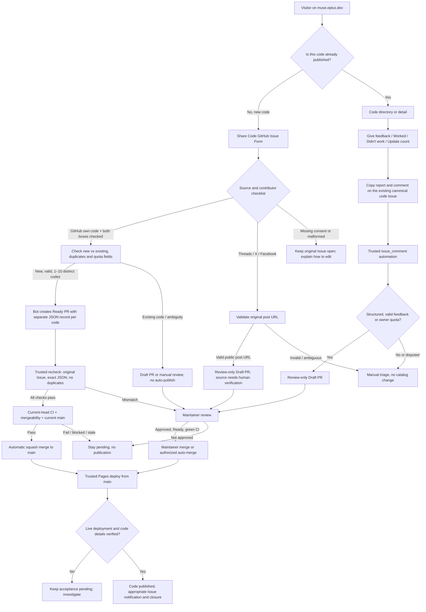
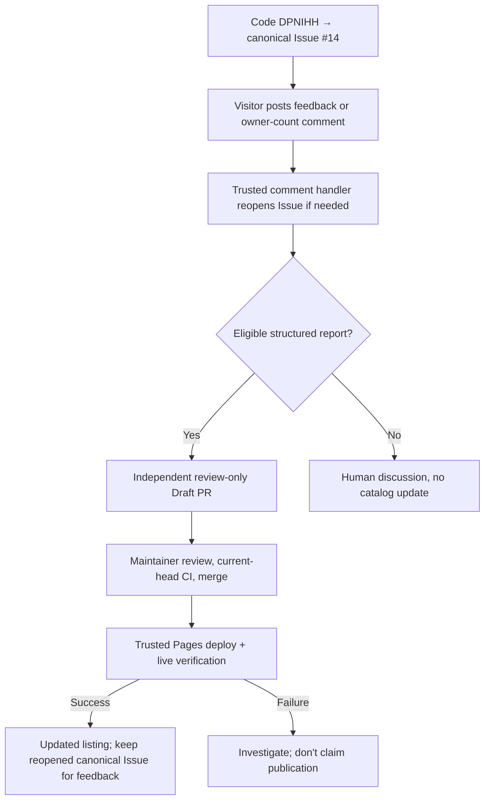

# Contribution and feedback flow

This page describes the **current production workflows** in Muse Invite Hub. **New self-reported GitHub invite codes can be published automatically as `unverified`** after strict checks; social-source submissions, updates to existing codes and feedback still require maintainer review. Publishing an entry does **not** verify that Muse will accept the code or that invitations remain.

See [CONTRIBUTING.md](../CONTRIBUTING.md) for contributor instructions, [AGENTS.md](../AGENTS.md) for mandatory rules, and [PROJECT_GUIDE.md](PROJECT_GUIDE.md) for implementation details.

## 1. Choose the right entry point

For grouped submissions (2–10 codes), each code is stored in its own `data/invite-records/<id>.json` record. Per-code quota/usage figures must be omitted for grouped Issues. Duplicate codes or an existing-code update are **not** eligible for automatic new-code publication.

## 2. Auto-publish vs review

| Submission or PR | Result |
| --- | --- |
| New **GitHub (my own code)** Issue; both contributor confirmations checked; no duplicate; exact bot-generated record(s) | Bot creates a **Ready PR**. Trusted automation verifies the original Issue, current catalog, all changed JSON files, green CI and clean merge before **automatic merge**. Entries publish as `unverified`. |
| New public code from **Threads, X (Twitter), Facebook** | Source URL and attribution require **human review**. The bot may create a **Draft PR**; no automatic publication. |
| Existing-code quota update, report, duplicate, source mismatch, ownership dispute | **Draft PR or manual triage**. Never auto-publish merely because CI succeeds. |
| Missing permission/privacy checklist or invalid form fields | **Original Issue remains open.** Bot explains how the contributor can edit that Issue; do not invent consent or require a new Issue. |
| Non-Draft documentation-only PR by **@hoangsvit** (`README.md`, `CONTRIBUTING.md`, Markdown under `docs/`; up to 15 files, no rename/deletion) | Separate low-risk default auto-merge policy after CI and mergeability checks. |
| Other code, workflow, configuration, mixed or third-party PR | Requires **@hoangsvit** approval on the current head or `/automerge FULL_40_CHARACTER_HEAD_SHA`; a new commit invalidates prior authorization. |

A `do-not-merge` label, `/automerge off` from @hoangsvit, Draft status, outstanding `CHANGES_REQUESTED`, failed/in-progress current-head validation, conflict or a branch behind `main` blocks automation. GitHub's native repository **Allow auto-merge** switch is separate: the trusted workflow enforces these custom conditions directly.

**Meaning of `unverified`:** A public code was submitted and passed repository validation; it is **not** independently redeemed, confirmed as working by Muse, or guaranteed to have remaining invites.

## 3. What happens to the GitHub Issue?

| Entry point | Before publication | After successful verified Pages deployment |
| --- | --- | --- |
| New-code Issue | Keep the original Issue open while its Ready (GitHub source) or Draft (social source) PR is processed | Post one acceptance comment with the canonical `https://muse.eplus.dev/codes/CODE/` link **before closing** the original Issue. That Issue remains the canonical feedback thread. |
| Structured comment on an **existing** code's canonical Issue | Human writes on the mapped Issue; trusted handler reopens it if needed and may propose a review-only Draft PR | The catalog reflects reviewed changes; do **not** automatically re-close a feedback-reopened canonical Issue. Comment-origin PRs do not currently receive a separate post-deployment acceptance comment. |
| Legacy standalone count/feedback Issue Form | Review-only Draft PR, sometimes linked as a sub-issue of the original code Issue | Once the change is live and verified, post the code link **then close the legacy report Issue**. The original code thread remains canonical. |
| Missing fields, conflicts, failed deploy, unverified source | Hold for manual review with the original discussion history | No automatic closure or claim of publication. |

The website uses `data/code-issues.json` to keep **one canonical GitHub Issue per published code**. A new form should be used for a new invite, not a duplicate feedback thread for an existing code.

## 4. Existing-code feedback example

The historical [Issue #86](https://github.com/ePlus-DEV/muse-invite-hub/issues/86) is an example of a legacy count report connected to the canonical [Issue #14](https://github.com/ePlus-DEV/muse-invite-hub/issues/14). It is not the preferred new submission flow.

## 5. Trusted automation boundaries

- [Issue to Draft PR](../.github/workflows/issue-to-pr.yml) / `scripts/issue-to-pr.mjs`: despite the historical workflow name, **new validated GitHub-owned codes create Ready PRs**, while social-source and update submissions create review-only Draft PRs. GitHub's `GITHUB_TOKEN`-created PRs explicitly dispatch validation.
- [Conditional PR auto-merge](../.github/workflows/auto-merge.yml) / `scripts/auto-merge.mjs`: trusted `main` code independently compares the current contributor Issue, exact per-code JSON records, PR provenance, checks and mergeability. It never executes unmerged PR scripts with write permissions.
- [Reopen Code Feedback Issue](../.github/workflows/reopen-code-feedback.yml): processes human comments on canonical Issues; only eligible structured reports propose review-only Draft PRs.
- [Deploy website to GitHub Pages](../.github/workflows/pages.yml) / `scripts/close-accepted-issues.mjs`: deploys from `main`, verifies live output, posts canonical code links, and closes only eligible submitted/legacy Issues **after** successful deployment. Auto-merge dispatches Pages explicitly because merges made using `GITHUB_TOKEN` do not trigger a normal `push` workflow.
- [Issue auto-triage PR #119](https://github.com/ePlus-DEV/muse-invite-hub/pull/119): adding type labels and assigning @hoangsvit is **a separate change**; do not assume it is deployed until that PR is merged.
- GitHub Issue labels, contributor self-reports and CI results are **not evidence of live Muse redemption**.

[Back to README](../README.md) · [Contribution instructions](../CONTRIBUTING.md) · [Project guide](PROJECT_GUIDE.md)
